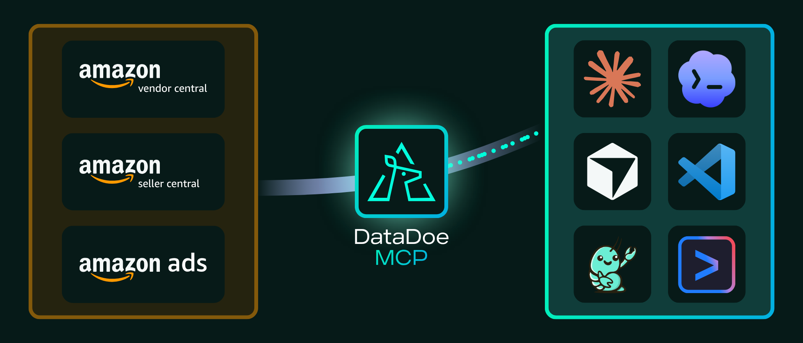

# Amazon Seller MCP Server by DataDoe

> **Hosted Amazon Seller Central, Vendor Central and Amazon Ads MCP server with read and write access.** Connect Claude, ChatGPT, Cursor, Codex, Gemini and other AI tools to your live Amazon data. Then let your AI agent act on it: update listings, manage orders and optimize Amazon Ads campaigns. DataDoe handles Amazon API approval, sign-in and rate limits for you.

[](https://click.deltologic.com/raffy-calendar)

[](https://www.datadoe.com/)
[](https://developer-docs.amazon.com/sp-api/)
[](https://advertising.amazon.com/API/docs)
[](https://modelcontextprotocol.io/)
[](#actions-act-on-your-amazon-account)
[](#step-by-step-guides-for-your-ai-tool)
[](https://github.com/Deltologic/datadoe-ai-skills)
[](https://smithery.ai/servers/jakopv007/datadoe-mcp)
[](LICENSE)

> 📅 **Want to see DataDoe in action?** [Book a demo call](https://click.deltologic.com/raffy-calendar) and we will show you how DataDoe works with your AI tools and your Amazon accounts.

🔗 [Start a 14-day free trial](https://www.datadoe.com/connect/amazon/mcp) · 📘 [Documentation](https://www.datadoe.com/hub/docs) · 📊 [Data scheme](https://www.datadoe.com/hub/data-scheme) · ⚡ [Actions](https://www.datadoe.com/hub/actions) · 🔔 [Webhooks](https://www.datadoe.com/hub/webhooks) · 🧠 [AI skills](https://github.com/Deltologic/datadoe-ai-skills) · 🎥 [Video demo](https://www.youtube.com/watch?v=9YQd7M2dMyY)

---

## What is DataDoe MCP?

**DataDoe** connects your Amazon Seller Central, Vendor Central and Amazon Ads accounts and keeps your data up to date in ready-to-use tables. **DataDoe MCP** gives AI tools access to that data through the [Model Context Protocol (MCP)](https://modelcontextprotocol.io/), the standard way for AI assistants to connect to other services.

Once connected, your AI assistant can:

- **Answer questions about your business:** sales, profit, ads, inventory, traffic, returns, settlements and more, down to each SKU and marketplace.
- **Build reports and dashboards:** weekly briefings, P&L statements, reconciliations and ad reviews, whenever you ask.
- **Make changes on Amazon for you:** with [Actions](#actions-act-on-your-amazon-account), it can update listings, manage orders and shipments, and optimize Amazon Ads. You can test every change first, and each type of Action stays off until you turn it on in DataDoe settings.

You do not need to install anything or write code. DataDoe runs the MCP server for you at `https://mcp.datadoe.com/mcp/v1`.



## Get started in 3 steps

1. **Create a DataDoe account** and connect your Amazon accounts. [Start a 14-day free trial](https://www.datadoe.com/connect/amazon/mcp).
2. **Add DataDoe to your AI tool.**
    - **Claude or ChatGPT:** add DataDoe as a connector with the URL `https://mcp.datadoe.com/mcp/v1` and sign in to DataDoe. You do not need a key. Follow the [Claude](https://www.datadoe.com/hub/docs/datadoe-mcp/claude) or [ChatGPT](https://www.datadoe.com/hub/docs/datadoe-mcp/chatgpt) guide.
    - **Any other AI tool:** follow its [step-by-step guide](#step-by-step-guides-for-your-ai-tool). Some tools also let you sign in; others need a DataDoe MCP key from [Integrations > MCP](https://app.datadoe.com/integrations/mcp).
3. **Ask a question**, for example: *"Show my top 10 ASINs by revenue last month across all Amazon marketplaces."*

## Who is DataDoe MCP for?

- **Amazon sellers (FBA, FBM, multi-marketplace):** get answers from your own data without opening Seller Central.
- **Amazon vendors:** read Vendor Central data with the same tools as Seller Central data.
- **Agencies:** work with every client account you connected from one place.
- **Operations and finance teams:** automate recurring reports and alerts.
- **AI builders and developers:** build Amazon-aware agents, apps and dashboards without your own Amazon API integration.

## What can you ask?

- *"What were my top 20 ASINs by revenue last month across all Amazon marketplaces?"*
- *"Reconcile my Amazon settlements against orders for Q1 and show any differences."*
- *"Which Amazon Ads campaigns had ACoS over 40% last week, and what did they spend?"*
- *"Which products will run out of stock in the next 14 days?"*
- *"Which search terms got the most clicks but no sales?"*
- *"What is my real profit per SKU after fees, ads and product costs?"*

With **Actions** enabled, your AI agent can also act on what it finds:

- *"Pause every campaign with ACoS over 50% last week."*
- *"Add the search terms that wasted the most money as negative keywords."*
- *"Update the bullet points of SKU ABC-123."*
- *"Confirm shipment for order 123-4567890-1234567 with UPS tracking 1Z999..."*

## Ready-made AI skills

Skip the prompt writing. The [DataDoe AI Skills](https://github.com/Deltologic/datadoe-ai-skills) repository has ready-made skills for common jobs: weekly sales briefings, profit and P&L reports, PPC wasted-spend checks, restock alerts, listing audits, Buy Box checks and more. Some skills can also apply changes, always with a test run first and your approval.

Install a skill with:

```bash
npx skills@latest add Deltologic/datadoe-ai-skills --skill SKILL_NAME
```

Browse all skills and agents in the [DataDoe Hub](https://www.datadoe.com/hub/ai-agents-and-skills).

## What Amazon data is available?

DataDoe MCP can read every table in DataDoe: more than 200 tables across Seller Central, Vendor Central and Amazon Ads, including:

- **Profit and finance:** profit by SKU and by day, settlements, fees, reimbursements, payouts and invoices.
- **Orders and sales:** order line items, sales and traffic, returns and refunds.
- **Amazon Ads:** Sponsored Products, Brands, Display and Television, Amazon DSP, search terms, targets, budgets, impression share and change history.
- **Inventory and fulfillment:** FBA inventory, restock recommendations, stranded and aged stock, inbound shipments, AWD and storage fees.
- **Listings and catalog:** listings, catalog attributes, Buy Box, competitive offers and listing issues.
- **Brand Analytics:** Search Query Performance, search terms, market basket and repeat purchases.
- **Vendor Central:** purchase orders, sales, traffic and inventory, forecasts, Direct Fulfillment and margins.
- **Near real-time events:** order changes, offer changes, listing status and inventory events.

Where to see every table and column:

- [Interactive data scheme in the DataDoe Hub](https://www.datadoe.com/hub/data-scheme)
- [Data scheme in this repository](scheme/data-scheme.md), with one page per table in [`scheme/data-scheme/`](scheme/data-scheme/)

## Actions: act on your Amazon account

Actions let your AI agent read and change your Amazon account through DataDoe. There are more than 200 Action types, for example:

- **Listings and A+ Content:** create, update, verify and delete listings, update prices and images, and manage A+ Content.
- **Orders and fulfillment:** find orders, cancel order items, confirm shipments, buy shipping labels, message buyers, and manage FBA, Multi-Channel Fulfillment, FBA inbound and External Fulfillment shipments.
- **Vendor Central:** acknowledge purchase orders, submit shipments and get labels and packing slips.
- **Amazon Ads:** find, create, update and remove campaigns, ad groups, targets and ads, and manage budget and bid rules, audiences, attribution and recommendations.
- **Account:** check balances and payouts, and work with Amazon action items.

Actions are safe by design:

- **Off until you turn them on.** Every Action type is disabled until someone in your Organization enables it in [Settings > Actions](https://app.datadoe.com/settings?tab=actions).
- **Test before you run.** Every Action supports a dry run (`dryRun: true`) that checks the request without sending anything to Amazon. Listing, A+ Content and Multi-Channel Fulfillment changes also have previews that Amazon checks without applying them.
- **You control access.** Changes need **Read and write** access for the account. DataDoe records every Action so you can review it later.

Where to see every Action and its fields:

- [Actions in the DataDoe Hub](https://www.datadoe.com/hub/actions) and the [Actions guide](https://www.datadoe.com/hub/docs/datadoe-features/actions)
- [Actions in this repository](scheme/actions.md), with the full JSON Schema of each Action in [`scheme/actions.json`](scheme/actions.json)

How an AI agent runs an Action:

1. Call `actions_details_schema_get` to get the fields the Action needs.
2. Call `actions_start` with `dryRun: true` to check the request.
3. Call `actions_start` to run the Action.
4. Call `actions_get` to check the result.

## Webhooks

DataDoe can also send events to your own systems as they happen, for example order updates, offer changes, listing status changes and inventory events. Use webhooks to trigger automations or keep your ERP or warehouse system in sync.

- [Webhooks guide](https://www.datadoe.com/hub/docs/datadoe-features/webhooks)
- [All webhook messages in the DataDoe Hub](https://www.datadoe.com/hub/webhooks)
- [Webhook scheme in this repository](scheme/webhooks.json)

## Pricing

DataDoe MCP is part of every DataDoe subscription: **$97 per month**, with a **14-day free trial** for new Organizations. Exports, Actions, webhooks and Amazon Marketing Cloud (AMC) queries use AI Tokens from your monthly balance. See [Subscription and pricing](https://www.datadoe.com/hub/docs/basics/subscription-pricing).

## Step-by-step guides for your AI tool

Start with the [DataDoe MCP overview](https://www.datadoe.com/hub/docs/datadoe-mcp/overview).

**Chat assistants**

- [Claude](https://www.datadoe.com/hub/docs/datadoe-mcp/claude)
- [ChatGPT](https://www.datadoe.com/hub/docs/datadoe-mcp/chatgpt)
- [Grok](https://www.datadoe.com/hub/docs/datadoe-mcp/grok)
- [Genspark](https://www.datadoe.com/hub/docs/datadoe-mcp/genspark)
- [Glama](https://www.datadoe.com/hub/docs/datadoe-mcp/glama-chat)
- [Littlebird](https://www.datadoe.com/hub/docs/datadoe-mcp/littlebird)
- [Superhuman](https://www.datadoe.com/hub/docs/datadoe-mcp/superhuman)

**Office apps**

- [Excel with Claude](https://www.datadoe.com/hub/docs/datadoe-mcp/excel)
- [PowerPoint with Claude](https://www.datadoe.com/hub/docs/datadoe-mcp/powerpoint)
- [Word with Claude](https://www.datadoe.com/hub/docs/datadoe-mcp/word)

**Coding agents and IDEs**

- [Claude Code](https://www.datadoe.com/hub/docs/datadoe-mcp/claude-code)
- [Codex](https://www.datadoe.com/hub/docs/datadoe-mcp/codex) and [Codex Sites](https://www.datadoe.com/hub/docs/datadoe-mcp/codex-sites)
- [Cursor](https://www.datadoe.com/hub/docs/datadoe-mcp/cursor)
- [Antigravity](https://www.datadoe.com/hub/docs/datadoe-mcp/antigravity)
- [Gemini CLI](https://www.datadoe.com/hub/docs/datadoe-mcp/gemini-cli)
- [VS Code](https://www.datadoe.com/hub/docs/datadoe-mcp/vs-code)
- [OpenCode](https://www.datadoe.com/hub/docs/datadoe-mcp/opencode)

**Autonomous agents and automation**

- [GrokBot](https://www.datadoe.com/hub/docs/datadoe-mcp/grokbot)
- [OpenClaw](https://www.datadoe.com/hub/docs/datadoe-mcp/openclaw)
- [NanoClaw](https://www.datadoe.com/hub/docs/datadoe-mcp/nanoclaw)
- [Hermes Agent](https://www.datadoe.com/hub/docs/datadoe-mcp/hermes)
- [n8n](https://www.datadoe.com/hub/docs/datadoe-mcp/n8n)
- [Gumloop](https://www.datadoe.com/hub/docs/datadoe-mcp/gumloop)
- [CrewAI](https://www.datadoe.com/hub/docs/datadoe-mcp/crewai)
- [Glama MCP Inspector](https://www.datadoe.com/hub/docs/datadoe-mcp/glama)

**Agent SDKs**

- [Claude Agent SDK](https://www.datadoe.com/hub/docs/datadoe-mcp/claude-agents-sdk)
- [OpenAI Agents SDK](https://www.datadoe.com/hub/docs/datadoe-mcp/openai-agents-sdk)

## Technical setup

This section is for developers and AI tools without a dedicated guide. DataDoe MCP is a remote MCP server:

- **URL**: `https://mcp.datadoe.com/mcp/v1`
- **Transport**: Streamable HTTP. If your client supports only stdio or SSE, bridge it with [`mcp-remote`](https://www.npmjs.com/package/mcp-remote).
- **Sign-in**: OAuth, where your client supports it, or the header `datadoe-mcp-key: <YOUR_DATADOE_MCP_KEY>`. Create a key in [Integrations > MCP](https://app.datadoe.com/integrations/mcp).

```json
{
  "mcpServers": {
    "datadoe": {
      "url": "https://mcp.datadoe.com/mcp/v1",
      "headers": {
        "datadoe-mcp-key": "<YOUR_DATADOE_MCP_KEY>"
      }
    }
  }
}
```

Claude Code:

```bash
claude mcp add datadoe "https://mcp.datadoe.com/mcp/v1" --transport http --header "datadoe-mcp-key: <YOUR_DATADOE_MCP_KEY>"
```

Put the server name and URL before `--header`. To sign in with OAuth instead, leave out `--header`, run `/mcp` in Claude Code and choose **Authenticate**.

GitHub Copilot in VS Code (`.vscode/mcp.json`):

```json
{
  "servers": {
    "datadoe": {
      "type": "http",
      "url": "https://mcp.datadoe.com/mcp/v1",
      "headers": {
        "datadoe-mcp-key": "<YOUR_DATADOE_MCP_KEY>"
      }
    }
  }
}
```

### Access and security

- Personal MCP keys and OAuth connections follow their owner's roles and access to accounts, Actions and data tables. Service account keys use their own permissions. See [Keys and service accounts](https://www.datadoe.com/hub/docs/basics/keys-and-service-accounts) and [Roles and permissions](https://www.datadoe.com/hub/docs/basics/roles-and-permissions).
- Personal data (PII) needs the **Access PII data** permission and Amazon PII access for the Organization.
- If your Organization uses its own domain prefix, copy the full server URL from [Integrations > MCP](https://app.datadoe.com/integrations/mcp).

## Available MCP tools

| Tool | Area | What it does |
|---|---|---|
| `datadoe_user_docs_table_of_contents_get` | Docs | Lists the pages of the DataDoe documentation. |
| `datadoe_user_docs_page_get` | Docs | Returns one DataDoe documentation page. |
| `organization_and_subscription_details_get` | Account | Returns your Organization, plan, billing health and AI Token balances. |
| `sellers_and_vendors_list` | Accounts | Lists the Amazon Sellers and Vendors connected to DataDoe. |
| `sellers_and_vendors_get` | Accounts | Returns one Seller or Vendor, including whether you need to reconnect it. |
| `sellers_and_vendors_rename` | Accounts | Renames a Seller or Vendor. |
| `sellers_and_vendors_invitation_create` | Accounts | Creates a link to connect a new Amazon account or reconnect one. |
| `sellers_and_vendors_invitations_get` | Accounts | Lists pending invitations or returns one invitation. |
| `sellers_and_vendors_invitation_revoke` | Accounts | Revokes a pending invitation. |
| `exports_sources_get` | Data | Searches DataDoe tables by keyword. |
| `exports_source_get` | Data | Returns the columns and details of one table. |
| `exports_create` | Data | Queries a table with filters, grouping, totals and date intervals, and returns CSV or JSON. |
| `exports_get` | Data | Returns the status of an export. |
| `exports_list` | Data | Lists exports. |
| `exports_raw_url_get` | Data | Returns a download link for a completed export. |
| `exports_raw_download` | Data | Returns the content of a completed export. |
| `exports_delete` | Data | Deletes an export. |
| `files_create` | Files | Uploads a file used by Actions, such as a listing image, A+ image or video ad asset. |
| `files_list` | Files | Lists uploaded files. |
| `files_get` | Files | Returns details of one file. |
| `files_download_url_get` | Files | Returns a download link for a file. |
| `files_delete` | Files | Deletes a file. |
| `actions_details_schema_get` | Actions | Returns the fields an Action type needs and whether it is enabled. |
| `actions_start` | Actions | Starts an Action, or tests it with `dryRun: true`. |
| `actions_acknowledge` | Actions | Releases an Action whose submission to Amazon was uncertain, after you have checked it on Amazon. |
| `actions_get` | Actions | Returns the status and result of an Action. |
| `actions_list` | Actions | Lists past Actions. |
| `cogs_upsert` | Product costs | Adds or updates product costs (COGS) for a Seller Central account. |
| `cogs_delete` | Product costs | Deletes product costs. |
| `cogs_missing_list` | Product costs | Lists SKUs sold in the last 30 days without a product cost. |
| `vendor_code_upsert` | Vendor codes | Adds or updates vendor codes for a Vendor Central account. |
| `vendor_code_delete` | Vendor codes | Deletes vendor codes. |
| `vendor_codes_missing_list` | Vendor codes | Lists ASINs sold in the last 30 days without a vendor code. |
| `kdp_royalty_parameters_upsert` | KDP | Adds or updates royalty parameters for Kindle Direct Publishing books. |
| `kdp_royalty_parameters_delete` | KDP | Deletes KDP royalty parameters. |
| `sqp_asins_get` | Search Query Performance | Returns the ASINs tracked in Search Query Performance. |
| `sqp_asins_add` | Search Query Performance | Adds ASINs to Search Query Performance. |
| `sqp_asins_remove` | Search Query Performance | Removes ASINs from Search Query Performance. |
| `plugins_get` | Plugins | Returns saved Memories, Skills and Files. |
| `plugins_memories_create` | Plugins | Saves a Memory. |
| `plugins_memories_edit` | Plugins | Edits a Memory. |
| `plugins_memories_delete` | Plugins | Deletes a Memory. |
| `plugins_skills_get` | Plugins | Returns a Skill file. |
| `plugins_files_get` | Plugins | Returns the content of a File. |
| `amc_workflows_find` | Amazon Marketing Cloud | Lists AMC workflows. |
| `amc_workflows_create` | Amazon Marketing Cloud | Creates an AMC workflow. |
| `amc_workflows_update` | Amazon Marketing Cloud | Updates an AMC workflow. |
| `amc_workflows_delete` | Amazon Marketing Cloud | Deletes an AMC workflow. |
| `amc_query_validate` | Amazon Marketing Cloud | Checks an AMC query without running it. |
| `amc_query_start` | Amazon Marketing Cloud | Runs an AMC query. |
| `amc_query_cancel` | Amazon Marketing Cloud | Cancels an AMC query. |
| `amc_query_results_find` | Amazon Marketing Cloud | Lists AMC query results. |
| `amc_query_result_get` | Amazon Marketing Cloud | Returns one AMC query result with download links. |
| `amc_schema_find` | Amazon Marketing Cloud | Returns AMC tables and fields. |
| `amc_operation_get` | Amazon Marketing Cloud | Returns the status of an AMC operation. |
| `amc_query_templates_find` | Amazon Marketing Cloud | Lists ready-made AMC query templates. |
| `amc_query_template_get` | Amazon Marketing Cloud | Returns one AMC query template. |
| `datadoe_support_ticket_create` | Support | Sends a request to DataDoe support. |
| `datadoe_support_ticket_check` | Support | Reads a support request and its reply. |
| `datadoe_support_ticket_update` | Support | Adds information to a support request. |

The full definition of every tool, including its input and output schema, is in [`scheme/mcp-tools.json`](scheme/mcp-tools.json). Amazon Marketing Cloud (AMC) is in beta. See [Amazon Marketing Cloud](https://www.datadoe.com/hub/docs/datadoe-features/amc).

---

## About this repository

This repository is the public schema facade of DataDoe MCP. MCP registries, users and AI agents use it to see everything DataDoe MCP offers before connecting. DataDoe hosts DataDoe MCP at `mcp.datadoe.com`. This repository does not connect to Amazon.

This repository contains:

| Path | Contents |
|---|---|
| [`scheme/mcp-tools.json`](scheme/mcp-tools.json) | Every tool of the hosted server, as MCP clients see it. |
| [`scheme/data-scheme.md`](scheme/data-scheme.md), [`scheme/data-scheme/`](scheme/data-scheme/), [`scheme/data-scheme.json`](scheme/data-scheme.json) | Every DataDoe table with its description and columns. |
| [`scheme/actions.md`](scheme/actions.md), [`scheme/actions.json`](scheme/actions.json) | Every Action type with its limits, result and details schema. |
| [`scheme/webhooks.json`](scheme/webhooks.json) | Every webhook message type with its fields. |
| [`src/index.ts`](src/index.ts) | The facade MCP server. |

The facade server:

- lists the same tools as the hosted server
- answers `exports_sources_get`, `exports_source_get` and `actions_details_schema_get` from the data scheme and Action scheme in `scheme/`
- offers the data scheme, Action scheme and webhook scheme as MCP resources (`datadoe://scheme/...`)
- returns an error for every other tool, because it has no access to Amazon data

### Run the facade locally

```bash
yarn install
yarn build
yarn start
```

The server uses stdio, so start it from an MCP client:

```json
{
  "mcpServers": {
    "datadoe-facade": {
      "command": "node",
      "args": ["/absolute/path/to/datadoe-mcp/dist/index.js"]
    }
  }
}
```

### Keep the facade up to date

The files in `scheme/` are generated. Do not edit them by hand.

- **Data scheme, Actions and webhooks:** run `yarn sync:scheme`. It downloads the public specification from the DataDoe API. To read another DataDoe API, such as a local one, set `DATADOE_SPEC_BASE_URL`, for example `DATADOE_SPEC_BASE_URL=http://localhost:3001/api/v1/spec yarn sync:scheme`.
- **Tools:** in DataDoe core, run `yarn mcp:facade-snapshot <path to this repository>/scheme/mcp-tools.json` from `services`.
- **Version:** bump the version in `src/index.ts` and `server.json` when you publish changes.

---

## Documentation and resources

- [DataDoe homepage](https://www.datadoe.com/)
- [DataDoe documentation](https://www.datadoe.com/hub/docs)
- [DataDoe MCP overview](https://www.datadoe.com/hub/docs/datadoe-mcp/overview)
- [Data scheme](https://www.datadoe.com/hub/data-scheme)
- [Actions](https://www.datadoe.com/hub/actions) and the [Actions guide](https://www.datadoe.com/hub/docs/datadoe-features/actions)
- [Webhooks](https://www.datadoe.com/hub/webhooks) and the [Webhooks guide](https://www.datadoe.com/hub/docs/datadoe-features/webhooks)
- [AI agents and skills](https://www.datadoe.com/hub/ai-agents-and-skills) and the [DataDoe AI Skills repository](https://github.com/Deltologic/datadoe-ai-skills)
- [DataDoe MCP product page](https://www.datadoe.com/connect/amazon/mcp)
- [DataDoe vs Amazon MCP comparison](https://www.datadoe.com/compare/datadoe-vs-amazon-mcp)
- [Video demo](https://www.youtube.com/watch?v=9YQd7M2dMyY)
- [Book a demo call](https://click.deltologic.com/raffy-calendar)

## License

[MIT](LICENSE). The schema facade in this repository is open source. The hosted MCP server, the DataDoe application and DataDoe infrastructure are proprietary and provided by DataDoe, Inc.

---

DataDoe is a product of DataDoe, Inc. · [datadoe.com](https://www.datadoe.com/)
