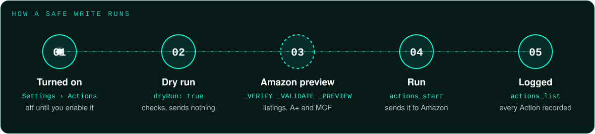
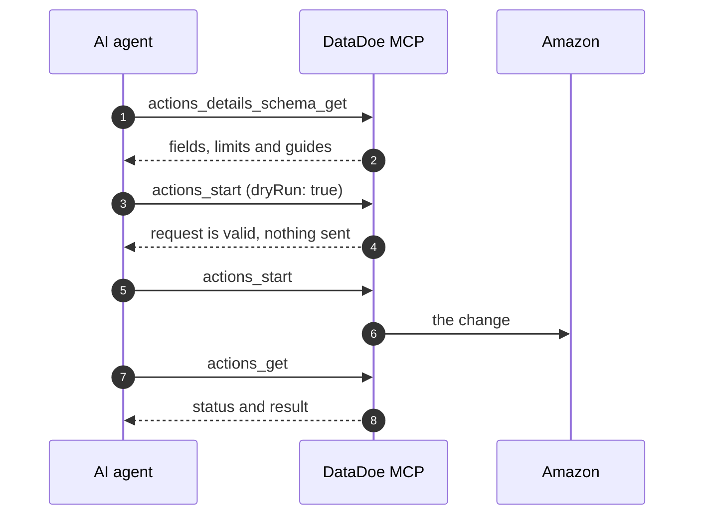

<div align="center">



# Amazon Seller MCP Server by DataDoe

**Hosted Amazon Seller Central, Vendor Central and Amazon Ads MCP server for the SP-API and Amazon Ads API, with read and write access.**<br/>
Connect Claude, ChatGPT, Cursor, Codex, Gemini and other AI tools to your live Amazon data.<br/>
Then let your AI agent act on it: update listings, manage orders and optimize Amazon Ads campaigns.<br/>
DataDoe handles Amazon API approval, sign-in and rate limits for you.

<br/>

[](https://click.deltologic.com/raffy-calendar)
&nbsp;
[](https://www.datadoe.com/connect/amazon/mcp)

[](https://www.datadoe.com/)
[](https://developer-docs.amazon.com/sp-api/)
[](https://advertising.amazon.com/API/docs)
[](https://modelcontextprotocol.io/)
[](#actions-act-on-your-amazon-account)
[](https://github.com/Deltologic/datadoe-ai-skills)
[](LICENSE)
[](https://glama.ai/mcp/servers/Deltologic/datadoe-mcp)

<br/>



<br/>

🔗 [**Start a 14-day free trial**](https://www.datadoe.com/connect/amazon/mcp) &nbsp;·&nbsp;
📘 [Documentation](https://www.datadoe.com/hub/docs) &nbsp;·&nbsp;
📊 [Data scheme](https://www.datadoe.com/hub/data-scheme) &nbsp;·&nbsp;
⚡ [Actions](https://www.datadoe.com/hub/actions) &nbsp;·&nbsp;
🔔 [Webhooks](https://www.datadoe.com/hub/webhooks) &nbsp;·&nbsp;
🧠 [AI skills](https://github.com/Deltologic/datadoe-ai-skills) &nbsp;·&nbsp;
🎥 [Video demo](https://www.youtube.com/watch?v=9YQd7M2dMyY) &nbsp;·&nbsp;
❓ [FAQ](#frequently-asked-questions)


</div>

## What is DataDoe MCP?

**DataDoe** connects your Amazon Seller Central, Vendor Central and Amazon Ads accounts and keeps your data up to date in ready-to-use tables. **DataDoe MCP** gives AI tools access to that data through the [Model Context Protocol (MCP)](https://modelcontextprotocol.io/), the standard way for AI assistants to connect to other services.

Once connected, your AI assistant can:

- answer questions about sales, profit, ads, inventory, traffic, returns, settlements and more, for each SKU and marketplace
- build reports and dashboards, such as weekly briefings, profit and loss (P&L) statements, reconciliations and ad reviews
- make changes on Amazon with [Actions](#actions-act-on-your-amazon-account), such as updating listings, managing orders and shipments, and optimizing Amazon Ads

You can test every change before it runs. Each Action type stays off until you turn it on in DataDoe settings.

> [!TIP]
> You do not need to install anything or write code. DataDoe runs the MCP server for you at `https://mcp.datadoe.com/mcp/v1`.

## Get started in three steps

1. Start a [14-day free trial of DataDoe](https://www.datadoe.com/connect/amazon/mcp) and connect your Amazon accounts.
2. Add DataDoe to your AI tool:
    - in Claude or ChatGPT, add a connector with the URL `https://mcp.datadoe.com/mcp/v1` and sign in to DataDoe without a key, as the [Claude guide](https://www.datadoe.com/hub/docs/datadoe-mcp/claude) and [ChatGPT guide](https://www.datadoe.com/hub/docs/datadoe-mcp/chatgpt) show
    - in any other AI tool, follow its [step-by-step guide](#step-by-step-guides-for-your-ai-tool), which says whether you sign in or use a key from the [MCP integrations page](https://app.datadoe.com/integrations/mcp)
3. Ask a question, for example *"Show my top 10 ASINs by revenue last month across all Amazon marketplaces."*

> [!NOTE]
> 📅 **Want to see DataDoe in action?** [Book a demo call](https://click.deltologic.com/raffy-calendar) and we will show you how DataDoe works with your AI tools and your Amazon accounts.

## Who is DataDoe MCP for?

| Who | What they get |
|---|---|
| **Amazon sellers** | Answers from your own data without opening Seller Central, whether you use Fulfillment by Amazon (FBA), fulfill orders yourself (FBM) or sell in many marketplaces. |
| **Amazon vendors** | Vendor Central data with the same tools as Seller Central data. |
| **Agencies** | All the client accounts you connected, in one place. |
| **Operations and finance teams** | Recurring reports and alerts, automated. |
| **AI builders and developers** | Agents, apps and dashboards on Amazon data without your own Amazon API integration. |

<div align="center"></div>

## What can you ask?

<div align="center">

</div>

<br/>

**Ask about your data:**

- *"What were my top 20 ASINs by revenue last month across all Amazon marketplaces?"*
- *"Reconcile my Amazon settlements against orders for Q1 and show any differences."*
- *"Which Amazon Ads campaigns had ACoS over 40% last week, and what did they spend?"*
- *"Which products will run out of stock in the next 14 days?"*
- *"Which search terms got the most clicks but no sales?"*
- *"What is my real profit per SKU after fees, ads and product costs?"*

**With Actions turned on, your AI agent can also act on what it finds:**

- *"Pause every campaign with ACoS over 50% last week."*
- *"Add the search terms that wasted the most money as negative keywords."*
- *"Update the bullet points of SKU ABC-123."*
- *"Confirm shipment for order 123-4567890-1234567 with UPS tracking 1Z999..."*

## Ready-made AI skills

Skip the prompt writing. The [DataDoe AI Skills repository](https://github.com/Deltologic/datadoe-ai-skills) has ready-made skills for common jobs, such as weekly sales briefings, profit reports, wasted ad spend checks, restock alerts, listing audits and Buy Box checks. Some skills can also apply changes. They always run a test first and wait for your approval.

Install a skill with:

```bash
npx skills@latest add Deltologic/datadoe-ai-skills --skill SKILL_NAME
```

Browse all skills and agents on the [AI agents and skills page in the DataDoe Hub](https://www.datadoe.com/hub/ai-agents-and-skills).

<div align="center"></div>

## What Amazon data is available?

DataDoe MCP can read every table in DataDoe. There are more than 200 tables across Seller Central, Vendor Central and Amazon Ads.

<div align="center">

</div>

<br/>

| Area | Examples |
|---|---|
| **Profit and finance** | profit by SKU and by day, settlements, fees, reimbursements, payouts and invoices |
| **Orders and sales** | order line items, sales and traffic, returns and refunds |
| **Amazon Ads** | Sponsored Products, Brands, Display and Television and Amazon DSP: search terms, targets, budgets, impression share and change history |
| **Inventory and fulfillment** | Fulfillment by Amazon (FBA) inventory, restock recommendations, stranded and aged stock, inbound shipments, Amazon Warehousing and Distribution (AWD) and storage fees |
| **Listings and catalog** | catalog attributes, Buy Box, competitive offers and listing issues |
| **Brand Analytics** | Search Query Performance, search terms, market basket and repeat purchases |
| **Vendor Central** | purchase orders, sales, traffic and inventory, forecasts, Direct Fulfillment and margins |
| **Near real-time events** | order changes, offer changes, listing status and inventory events |

See every table and column in the [interactive data scheme in the DataDoe Hub](https://www.datadoe.com/hub/data-scheme) or in the [data scheme index in this repository](scheme/data-scheme.md), which links to [one page per table](scheme/data-scheme/).

## Actions: act on your Amazon account

Actions let your AI agent read and change your Amazon account through DataDoe. With more than 200 Action types, your AI agent can:

- create, update, check and delete listings, update prices and images, and manage A+ Content
- find orders, cancel order items, confirm shipments, buy shipping labels and message buyers
- manage Fulfillment by Amazon (FBA), Multi-Channel Fulfillment, FBA inbound and External Fulfillment shipments
- acknowledge Vendor Central purchase orders, submit shipments, and get labels and packing slips
- find, create, update and remove Amazon Ads campaigns, ad groups, targets and ads
- manage Amazon Ads budget and bid rules, audiences, attribution and recommendations
- check balances and payouts, and work with Amazon action items

<div align="center">

</div>

### How DataDoe protects your account

<div align="center">

</div>

> [!IMPORTANT]
> - every Action type stays off until someone in your Organization turns it on in [Actions settings](https://app.datadoe.com/settings?tab=actions)
> - every Action supports a dry run (`dryRun: true`) that checks the request without sending anything to Amazon
> - listing, A+ Content and Multi-Channel Fulfillment changes also have previews that Amazon checks without applying them
> - changes need Read and write access for the account
> - DataDoe records every Action so you can review it later

See every Action type and its fields on the [Actions page in the DataDoe Hub](https://www.datadoe.com/hub/actions), in the [Actions guide](https://www.datadoe.com/hub/docs/datadoe-features/actions) or in the [Actions list in this repository](scheme/actions.md). The [Action scheme file](scheme/actions.json) has the full JSON Schema of each Action.

How an AI agent runs an Action:

1. Call `actions_details_schema_get` to get the fields the Action needs.
2. Call `actions_start` with `dryRun: true` to check the request.
3. Call `actions_start` to run the Action.
4. Call `actions_get` to check the result.

<details>
<summary><b>Same flow as a sequence diagram</b></summary>

<br/>



</details>

## Webhooks

DataDoe can also send events to your own systems as they happen, for example order updates, offer changes, listing status changes and inventory events. Use webhooks to start automations or keep your enterprise resource planning (ERP) or warehouse system in sync.

Read the [webhooks guide](https://www.datadoe.com/hub/docs/datadoe-features/webhooks), see [all webhook messages in the DataDoe Hub](https://www.datadoe.com/hub/webhooks) or open the [webhook scheme in this repository](scheme/webhooks.json).

## Pricing

DataDoe MCP is part of every DataDoe subscription, with a 14-day free trial for new Organizations. Exports, Actions, webhooks and Amazon Marketing Cloud (AMC) queries use AI Tokens from your monthly balance. See [Subscription and pricing](https://www.datadoe.com/hub/docs/basics/subscription-pricing) for the current price.

<div align="center"></div>

## Step-by-step guides for your AI tool

Start with the [DataDoe MCP overview](https://www.datadoe.com/hub/docs/datadoe-mcp/overview).

### Chat assistants

- [Claude](https://www.datadoe.com/hub/docs/datadoe-mcp/claude)
- [ChatGPT](https://www.datadoe.com/hub/docs/datadoe-mcp/chatgpt)
- [Grok](https://www.datadoe.com/hub/docs/datadoe-mcp/grok)
- [Genspark](https://www.datadoe.com/hub/docs/datadoe-mcp/genspark)
- [Glama](https://www.datadoe.com/hub/docs/datadoe-mcp/glama-chat)
- [Littlebird](https://www.datadoe.com/hub/docs/datadoe-mcp/littlebird)
- [Superhuman](https://www.datadoe.com/hub/docs/datadoe-mcp/superhuman)

### Office apps

- [Excel with Claude](https://www.datadoe.com/hub/docs/datadoe-mcp/excel)
- [PowerPoint with Claude](https://www.datadoe.com/hub/docs/datadoe-mcp/powerpoint)
- [Word with Claude](https://www.datadoe.com/hub/docs/datadoe-mcp/word)

### Coding agents and code editors

- [Claude Code](https://www.datadoe.com/hub/docs/datadoe-mcp/claude-code)
- [Codex](https://www.datadoe.com/hub/docs/datadoe-mcp/codex) and [Codex Sites](https://www.datadoe.com/hub/docs/datadoe-mcp/codex-sites)
- [Cursor](https://www.datadoe.com/hub/docs/datadoe-mcp/cursor)
- [Antigravity](https://www.datadoe.com/hub/docs/datadoe-mcp/antigravity)
- [Gemini CLI](https://www.datadoe.com/hub/docs/datadoe-mcp/gemini-cli)
- [VS Code](https://www.datadoe.com/hub/docs/datadoe-mcp/vs-code)
- [OpenCode](https://www.datadoe.com/hub/docs/datadoe-mcp/opencode)

### Autonomous agents and automation

- [GrokBot](https://www.datadoe.com/hub/docs/datadoe-mcp/grokbot)
- [OpenClaw](https://www.datadoe.com/hub/docs/datadoe-mcp/openclaw)
- [NanoClaw](https://www.datadoe.com/hub/docs/datadoe-mcp/nanoclaw)
- [Hermes Agent](https://www.datadoe.com/hub/docs/datadoe-mcp/hermes)
- [n8n](https://www.datadoe.com/hub/docs/datadoe-mcp/n8n)
- [Gumloop](https://www.datadoe.com/hub/docs/datadoe-mcp/gumloop)
- [CrewAI](https://www.datadoe.com/hub/docs/datadoe-mcp/crewai)
- [Glama MCP Inspector](https://www.datadoe.com/hub/docs/datadoe-mcp/glama)

### Agent development kits

- [Claude Agent SDK](https://www.datadoe.com/hub/docs/datadoe-mcp/claude-agents-sdk)
- [OpenAI Agents SDK](https://www.datadoe.com/hub/docs/datadoe-mcp/openai-agents-sdk)

## Technical setup

This section is for developers and AI tools without a dedicated guide. DataDoe MCP is a remote MCP server with:

- the URL `https://mcp.datadoe.com/mcp/v1`
- the Streamable HTTP transport, which clients that support only stdio or Server-Sent Events (SSE) can reach through [`mcp-remote`](https://www.npmjs.com/package/mcp-remote)
- OAuth sign-in where your client supports it, or the header `datadoe-mcp-key: <YOUR_DATADOE_MCP_KEY>` with a key from the [MCP integrations page](https://app.datadoe.com/integrations/mcp)

```json
{
  "mcpServers": {
    "datadoe": {
      "url": "https://mcp.datadoe.com/mcp/v1",
      "headers": {
        "datadoe-mcp-key": "<YOUR_DATADOE_MCP_KEY>"
      }
    }
  }
}
```

Claude Code:

```bash
claude mcp add datadoe "https://mcp.datadoe.com/mcp/v1" --transport http --header "datadoe-mcp-key: <YOUR_DATADOE_MCP_KEY>"
```

Put the server name and URL before `--header`. To sign in with OAuth instead, leave out `--header`, run `/mcp` in Claude Code and choose **Authenticate**.

<details>
<summary><b>GitHub Copilot in VS Code</b> (<code>.vscode/mcp.json</code>)</summary>

<br/>

```json
{
  "servers": {
    "datadoe": {
      "type": "http",
      "url": "https://mcp.datadoe.com/mcp/v1",
      "headers": {
        "datadoe-mcp-key": "<YOUR_DATADOE_MCP_KEY>"
      }
    }
  }
}
```

</details>

### Access and security

Personal MCP keys and OAuth connections follow their owner's roles and access to accounts, Actions and data tables. Service account keys use their own permissions. Read more about [keys and service accounts](https://www.datadoe.com/hub/docs/basics/keys-and-service-accounts) and [roles and permissions](https://www.datadoe.com/hub/docs/basics/roles-and-permissions).

To read personal data, also called personally identifiable information (PII), a user needs the **Access PII data** permission, and the Organization needs Amazon PII access.

> [!NOTE]
> If your Organization uses its own domain prefix, copy the full server URL from the [MCP integrations page](https://app.datadoe.com/integrations/mcp).

## Available MCP tools

The [tool definitions file](scheme/mcp-tools.json) has the input and output schema of every tool. Amazon Marketing Cloud (AMC) is in beta. Read the [Amazon Marketing Cloud guide](https://www.datadoe.com/hub/docs/datadoe-features/amc). DataDoe Studio builds and runs solutions for an Organization. Only Organization admins can use it.

<details>
<summary><b>Every tool of the hosted server, by area</b> (click to open)</summary>

<br/>

| Tool | Area | What it does |
|---|---|---|
| `datadoe_user_docs_table_of_contents_get` | Docs | Lists the pages of the DataDoe documentation. |
| `datadoe_user_docs_page_get` | Docs | Returns one DataDoe documentation page. |
| `organization_and_subscription_details_get` | Account | Returns your Organization, plan, billing health and AI Token balances. |
| `sellers_and_vendors_list` | Accounts | Lists the Amazon Sellers and Vendors connected to DataDoe. |
| `sellers_and_vendors_get` | Accounts | Returns one Seller or Vendor, including whether you need to reconnect it. |
| `sellers_and_vendors_rename` | Accounts | Renames a Seller or Vendor. |
| `sellers_and_vendors_invitation_create` | Accounts | Creates a link to connect a new Amazon account or reconnect one. |
| `sellers_and_vendors_invitations_get` | Accounts | Lists pending invitations or returns one invitation. |
| `sellers_and_vendors_invitation_revoke` | Accounts | Revokes a pending invitation. |
| `exports_sources_get` | Data | Searches DataDoe tables by keyword. |
| `exports_source_get` | Data | Returns the columns and details of one table. |
| `exports_create` | Data | Queries a table with filters, grouping, totals and date intervals, and returns CSV or JSON. |
| `exports_get` | Data | Returns the status of an export. |
| `exports_list` | Data | Lists exports. |
| `exports_raw_url_get` | Data | Returns a download link for a completed export. |
| `exports_raw_download` | Data | Returns the content of a completed export. |
| `exports_delete` | Data | Deletes an export. |
| `files_create` | Files | Uploads a file used by Actions, such as a listing image, A+ image or video ad asset. |
| `files_list` | Files | Lists uploaded files. |
| `files_get` | Files | Returns details of one file. |
| `files_download_url_get` | Files | Returns a download link for a file. |
| `files_delete` | Files | Deletes a file. |
| `actions_details_schema_get` | Actions | Returns the fields an Action type needs, whether it is enabled, and its description, result, group, item limit and guides. |
| `actions_start` | Actions | Starts an Action, or tests it with `dryRun: true`. |
| `actions_acknowledge` | Actions | Releases an Action whose submission to Amazon was uncertain, after you have checked it on Amazon. |
| `actions_get` | Actions | Returns the status and result of an Action. |
| `actions_list` | Actions | Lists past Actions. |
| `cogs_upsert` | Product costs | Adds or updates product costs (COGS) for a Seller Central account. |
| `cogs_delete` | Product costs | Deletes product costs. |
| `cogs_missing_list` | Product costs | Lists SKUs sold in the last 30 days without a product cost. |
| `vendor_code_upsert` | Vendor codes | Adds or updates vendor codes for a Vendor Central account. |
| `vendor_code_delete` | Vendor codes | Deletes vendor codes. |
| `vendor_codes_missing_list` | Vendor codes | Lists ASINs sold in the last 30 days without a vendor code. |
| `kdp_royalty_parameters_upsert` | KDP | Adds or updates royalty parameters for Kindle Direct Publishing books. |
| `kdp_royalty_parameters_delete` | KDP | Deletes KDP royalty parameters. |
| `sqp_asins_get` | Search Query Performance | Returns the ASINs tracked in Search Query Performance. |
| `sqp_asins_add` | Search Query Performance | Adds ASINs to Search Query Performance. |
| `sqp_asins_remove` | Search Query Performance | Removes ASINs from Search Query Performance. |
| `plugins_get` | Plugins | Returns saved Memories, Skills and Files. |
| `plugins_memories_create` | Plugins | Saves a Memory. |
| `plugins_memories_edit` | Plugins | Edits a Memory. |
| `plugins_memories_delete` | Plugins | Deletes a Memory. |
| `plugins_skills_get` | Plugins | Returns a Skill file. |
| `plugins_files_get` | Plugins | Returns the content of a File. |
| `amc_workflows_find` | Amazon Marketing Cloud | Lists AMC workflows. |
| `amc_workflows_create` | Amazon Marketing Cloud | Creates an AMC workflow. |
| `amc_workflows_update` | Amazon Marketing Cloud | Updates an AMC workflow. |
| `amc_workflows_delete` | Amazon Marketing Cloud | Deletes an AMC workflow. |
| `amc_query_validate` | Amazon Marketing Cloud | Checks an AMC query without running it. |
| `amc_query_start` | Amazon Marketing Cloud | Runs an AMC query. |
| `amc_query_cancel` | Amazon Marketing Cloud | Cancels an AMC query. |
| `amc_query_results_find` | Amazon Marketing Cloud | Lists AMC query results. |
| `amc_query_result_get` | Amazon Marketing Cloud | Returns one AMC query result with download links. |
| `amc_schema_find` | Amazon Marketing Cloud | Returns AMC tables and fields. |
| `amc_operation_get` | Amazon Marketing Cloud | Returns the status of an AMC operation. |
| `amc_query_templates_find` | Amazon Marketing Cloud | Lists ready-made AMC query templates. |
| `amc_query_template_get` | Amazon Marketing Cloud | Returns one AMC query template. |
| `studio_get` | Studio | Returns whether DataDoe Studio is available for the Organization. |
| `studio_solutions_create` | Studio | Asks DataDoe Studio to create a solution and returns a job. |
| `studio_solutions_list` | Studio | Lists Studio solutions, with type, status, trigger and whether they are paused. |
| `studio_solutions_get` | Studio | Returns one Studio solution, including its input and output schema. |
| `studio_solutions_configure` | Studio | Pauses or resumes a solution, or changes its trigger or schedule. |
| `studio_solutions_update` | Studio | Asks DataDoe Studio to change an active solution and returns a job. |
| `studio_solutions_delete` | Studio | Deletes a Studio solution and returns a job. |
| `studio_jobs_get` | Studio | Returns the status and result of a Studio job. |
| `studio_solutions_execute` | Studio | Runs an active Studio solution that has an HTTP request trigger. |
| `studio_executions_get` | Studio | Returns the status and output of a Studio execution. |
| `studio_executions_list` | Studio | Lists executions of a Studio solution, newest first. |
| `datadoe_support_ticket_create` | Support | Sends a request to DataDoe support. |
| `datadoe_support_ticket_check` | Support | Reads a support request and its reply. |
| `datadoe_support_ticket_update` | Support | Adds information to a support request. |

</details>

<div align="center"></div>

## Frequently asked questions

### Is there an MCP server for Amazon Seller Central?

Yes. DataDoe MCP is a hosted MCP server for Amazon Seller Central. It reads your Seller Central data, such as orders, profit, inventory, listings and settlements, and runs Actions on your account, such as listing updates and shipment confirmations. Connect it at `https://mcp.datadoe.com/mcp/v1`.

### Is there an MCP server for Amazon Vendor Central?

Yes. DataDoe MCP reads Vendor Central data, such as purchase orders, sales, traffic, inventory and forecasts, and runs Vendor Actions, such as acknowledging purchase orders and submitting shipments.

### Is there an Amazon Ads MCP server?

Yes. DataDoe MCP reads Amazon Ads data for Sponsored Products, Brands, Display and Television and for Amazon DSP, and runs Amazon Ads Actions, such as managing campaigns, ad groups, targets, budget rules and bid rules.

### Is DataDoe MCP an Amazon SP-API MCP server? Do I need my own SP-API developer account?

DataDoe MCP works on top of the Amazon Selling Partner API (SP-API) and the Amazon Ads API. You do not need your own developer account: DataDoe handles Amazon API approval, sign-in and rate limits for you.

### How do I connect Claude or ChatGPT to Amazon Seller Central?

Add a connector with the URL `https://mcp.datadoe.com/mcp/v1` and sign in to DataDoe. The [Claude guide](https://www.datadoe.com/hub/docs/datadoe-mcp/claude) and [ChatGPT guide](https://www.datadoe.com/hub/docs/datadoe-mcp/chatgpt) show each step. Other tools are in the [step-by-step guides](#step-by-step-guides-for-your-ai-tool).

### Can an AI agent change my Amazon account?

Only when you allow it. Every Action type stays off until someone in your Organization turns it on, every Action supports a dry run, and DataDoe records every Action. Read [how DataDoe protects your account](#how-datadoe-protects-your-account).

### How is DataDoe MCP different from Amazon's own MCP servers?

See the [DataDoe vs Amazon MCP comparison](https://www.datadoe.com/compare/datadoe-vs-amazon-mcp).

### Is DataDoe MCP open source?

The schema facade in this repository is open source under the MIT license. The hosted server at `mcp.datadoe.com` is part of a DataDoe subscription, with a 14-day free trial.

<div align="center"></div>

## About this repository

This repository is the public schema facade of DataDoe MCP: a copy of everything DataDoe MCP offers, without access to any data. MCP registries, users and AI agents use it to see what DataDoe MCP can do before connecting. DataDoe hosts DataDoe MCP at `mcp.datadoe.com`. This repository does not connect to Amazon.

This repository contains:

| Path | Contents |
|---|---|
| [`scheme/mcp-tools.json`](scheme/mcp-tools.json) | Every tool of the hosted server, as MCP clients see it. |
| [`scheme/data-scheme.md`](scheme/data-scheme.md), [`scheme/data-scheme/`](scheme/data-scheme/), [`scheme/data-scheme.json`](scheme/data-scheme.json) | Every DataDoe table with its description and columns. |
| [`scheme/actions.md`](scheme/actions.md), [`scheme/actions.json`](scheme/actions.json) | Every Action type with its limits, result and details schema. |
| [`scheme/webhooks.json`](scheme/webhooks.json) | Every webhook message type with its fields. |
| [`src/index.ts`](src/index.ts) | The facade MCP server. |
| [`.github/readme/`](.github/readme/) | The images of this README and `build.py`, which draws them from `scheme/`. |

The facade server:

- lists the same tools as the hosted server
- answers `exports_sources_get`, `exports_source_get` and `actions_details_schema_get` from the data scheme and Action scheme in `scheme/`
- offers the data scheme, Action scheme and webhook scheme as MCP resources (`datadoe://scheme/...`)
- returns an error for every other tool, because it has no access to Amazon data

### Run the facade locally

```bash
yarn install
yarn build
yarn start
```

The server uses stdio, so start it from an MCP client:

```json
{
  "mcpServers": {
    "datadoe-facade": {
      "command": "node",
      "args": ["/absolute/path/to/datadoe-mcp/dist/index.js"]
    }
  }
}
```

### Keep the facade up to date

Scripts generate the files in `scheme/`, so do not edit them by hand. To update them:

- run `yarn sync:scheme` to download the data scheme, Actions and webhooks from the public DataDoe API specification
- set `DATADOE_SPEC_BASE_URL` to read another DataDoe API, such as a local one, for example `DATADOE_SPEC_BASE_URL=http://localhost:3001/api/v1/spec yarn sync:scheme`
- run `yarn mcp:facade-snapshot <path to this repository>/scheme/mcp-tools.json` from `services` in DataDoe core to update the tools
- run `python3 .github/readme/build.py` to redraw the README images, so their counts match `scheme/` (Python 3.9+, no packages)
- bump the version in `src/index.ts` and `server.json` when you publish changes

<div align="center"></div>

## Documentation and resources

- [DataDoe homepage](https://www.datadoe.com/)
- [DataDoe documentation](https://www.datadoe.com/hub/docs)
- [DataDoe MCP overview](https://www.datadoe.com/hub/docs/datadoe-mcp/overview)
- [Data scheme](https://www.datadoe.com/hub/data-scheme)
- [Actions](https://www.datadoe.com/hub/actions) and the [Actions guide](https://www.datadoe.com/hub/docs/datadoe-features/actions)
- [Webhooks](https://www.datadoe.com/hub/webhooks) and the [Webhooks guide](https://www.datadoe.com/hub/docs/datadoe-features/webhooks)
- [AI agents and skills](https://www.datadoe.com/hub/ai-agents-and-skills) and the [DataDoe AI Skills repository](https://github.com/Deltologic/datadoe-ai-skills)
- [DataDoe MCP product page](https://www.datadoe.com/connect/amazon/mcp)
- [DataDoe vs Amazon MCP comparison](https://www.datadoe.com/compare/datadoe-vs-amazon-mcp)
- [Video demo](https://www.youtube.com/watch?v=9YQd7M2dMyY)
- [Book a demo call](https://click.deltologic.com/raffy-calendar)

## License

The schema facade in this repository is open source under the [MIT license](LICENSE). DataDoe, Inc. provides the hosted MCP server, the DataDoe application and DataDoe infrastructure as proprietary software.

<div align="center">


DataDoe is a product of DataDoe, Inc. · [datadoe.com](https://www.datadoe.com/)

</div>
